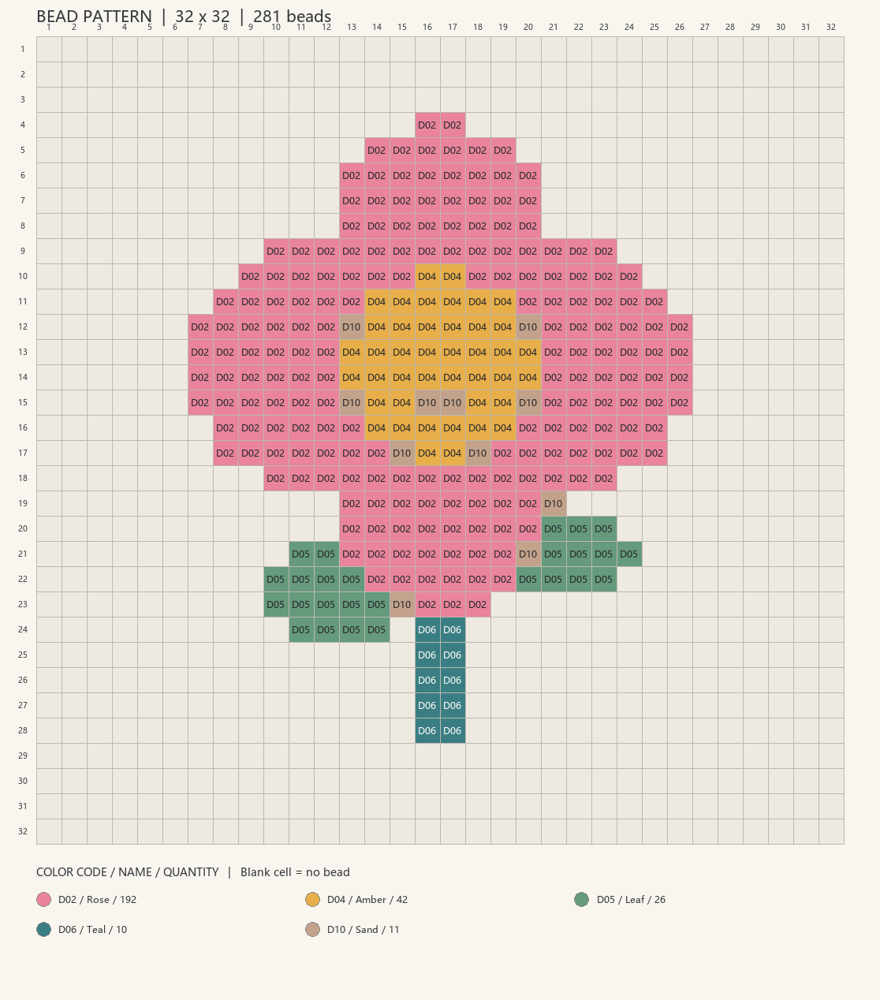
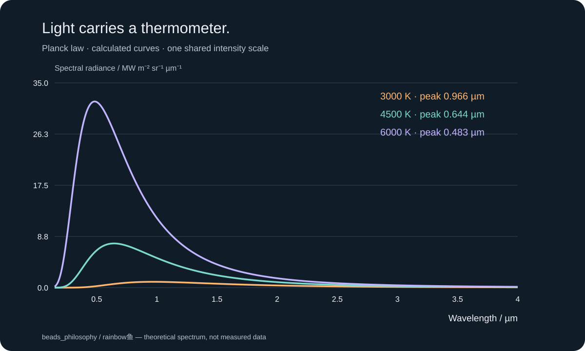

# beads_philosophy

**一颗拼豆，到底能走多远？**

从一张图片开始，给颜色编号，把平面搭成立体，让模型沿着真实切片路径逐层成形。最后，把“最小的一份是什么”这个问题带到量子物理。

这是 **rainbow鱼 · 每天5分钟科普·最小尺度** 的配套工具与阅读资料。你可以换上自己的图片和模型，亲手走一遍影片里的过程。

| 想做什么 | 从这里开始 | 可以得到什么 |
| --- | --- | --- |
| 图片转拼豆豆号 | [beads/](beads/README.md) | 编号图纸、像素预览、颜色数量清单；支持自己的品牌色卡 |
| 三维模型搭成 Minecraft 方块 | [minecraft/](minecraft/README.md) | 体素方块、材料数量、Litematica 投影文件 |
| 游戏内投影建造与镜头回放 | [Minecraft 模组指南](minecraft/README.md) | 一组相互匹配的官方模组来源、下载校验与使用步骤 |
| 看清切片、打印路径与支撑 | [printing/](printing/README.md) | 逐层路径预览、悬垂识别、支撑候选几何 |
| 理解普朗克与“最小尺度” | [quantum/](quantum/README.md) | 中文入门笔记、公开课程、原始资料链接与黑体光谱演示 |

## 先试一张图



这张图的每个编号都来自色卡，空格不放豆子。示例里的 `D01–D10` 是演示编号；要匹配手里的真实豆子，把色卡换成对应品牌的 `code,name,hex` CSV 即可。

## 在自己的电脑运行

需要 **Python 3.11 或更新版本**。下面的命令在仓库根目录执行。没有安装 Git 也可以在仓库页面选择 **Code → Download ZIP**，解压后在该目录创建虚拟环境。

```bash
git clone https://github.com/rainbowyuyu/beads_philosophy.git
cd beads_philosophy
python -m venv .venv
```

Windows PowerShell 使用虚拟环境中的解释器，无须修改执行策略：

```powershell
.\.venv\Scripts\python.exe -m pip install -r requirements.txt
.\.venv\Scripts\python.exe beads/image_to_beads.py beads/examples/flower.png --width 32 --output outputs/flower
```

macOS / Linux：

```bash
.venv/bin/python -m pip install -r requirements.txt
.venv/bin/python beads/image_to_beads.py beads/examples/flower.png --width 32 --output outputs/flower
```

打开 `outputs/flower/numbered-chart.png` 或 `numbered-chart.svg`，就能看到图纸。JSON 保留每格数据，CSV 可以用表格软件打开。

只想体验拼豆工具，可以只安装 `numpy` 和 `Pillow`。完整依赖用于三维模型、切片与支撑模块。每个子目录都有自己的输入要求、命令、示例和输出说明。

## 从图纸走到立体

**图片 → 颜色格网 → 体素方块 → 三角网格 → 切片与路径。**

这几种表示能指向同一个形状，却各有用途：格网告诉你颜色放在哪里，体素告诉你空间被哪些方块占据，网格描述表面，切片把表面转成逐层路径。

单张照片没有唯一的背面。本仓库的图片工具生成平面图纸；立体工具读取你提供的三维模型，不会把一张图片自动变成经过验证的三维扫描。

## 带着问题往物理学走



拼豆和像素的大小可以由我们选择。普朗克面对的则是另一个问题：热的物体为何发出这样的光谱？为解释实验结果，他在推导中引入了能量元。

从这里开始，[量子资料](quantum/README.md) 会把“某些体系的离散能级”和“时空是否有最小单位”分开讲。普朗克长度与普朗克时间是重要的自然尺度，目前尚未被证明就是空间、时间最小的积木。

## 示例与适用范围

- 示例图片和几何由本仓库程序生成，可以随代码使用。影片中的角色原图、专属模型、音乐和原版游戏贴图没有打包。
- Litematica、MaLiLib、Replay Mod 等通过官方来源获取，按各自许可证使用。安装模组时，游戏版本与加载器必须匹配。
- 打印模块用于几何切片、路径动画和支撑方案学习。实际制作请把模型送进专业切片器，选择自己的打印机、材料和参数；这里的支撑候选没有经过实体打印或力学验证。
- 代码与原创示例采用 [MIT 许可证](LICENSE)，第三方资料见 [来源与许可说明](THIRD_PARTY_NOTICES.md)。

## 复现与反馈

运行 [验证说明](docs/validation.md) 中的命令，可以检查豆数、投影数据、切片几何和物理公式。演示通过与游戏内实测、实物打印是不同的检查，报告会分别说明。

发现问题可以在 [Issues](https://github.com/rainbowyuyu/beads_philosophy/issues) 留下输入格式、运行命令和报错。请使用你有权分享的示例文件，避免上传个人照片或私密模型。

**这期用到的拼豆转图纸、方块投影与回放模组、3D 打印演示和量子入门资料，都整理在这个仓库。需要的话，可以在视频平台私信 rainbow鱼，或从主页链接进入 `beads_philosophy`。**
