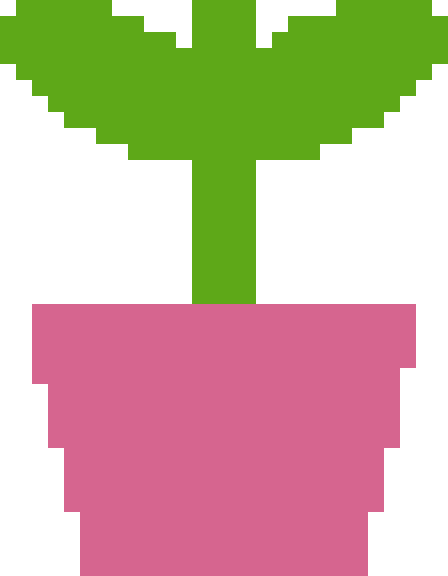

# 从一个三维模型，到可以逐块搭建的作品

输入自己的 GLB、OBJ 或 STL，把模型采样为真实的三维方块占据格，输出 **Litematica 投影文件、材料清单和逐层坐标**。然后用 Litematica 辅助搭建，用 Replay Mod 记录这段过程。

这里的投影和回放使用现有社区模组。本仓库提供转换代码、版本锁和带校验的官方下载器，不重新打包模组、不附带 Minecraft 游戏或游戏贴图。

## 先跑一个例子

在仓库根目录，使用已安装根目录 `requirements.txt` 依赖的 Python。下文 `python` 指根 README 中的虚拟环境解释器：Windows 为 `.\.venv\Scripts\python.exe`，macOS / Linux 为 `.venv/bin/python`。

```bash
python minecraft/examples/make_demo.py --out output/minecraft/demo-sprout.glb
python minecraft/model_to_blocks.py output/minecraft/demo-sprout.glb --out output/minecraft/sprout --max-axis 36 --solid
```

示例是代码生成的原创豆芽小雕塑，可自由改造。已经生成的 [GLB](examples/demo-sprout.glb)、[投影文件](examples/demo-output/build.litematic)、[材料清单](examples/demo-output/materials.csv) 和 [逐层坐标](examples/demo-output/build-order.csv) 可直接查看。



替换成自己的模型：

```bash
# GLB/glTF 一般采用 Y 轴朝上。先做外壳，适合大型建筑。
python minecraft/model_to_blocks.py your-model.glb --out output/minecraft/my-build --max-axis 64

# STL 常用 Z 轴朝上；封闭模型可填实内部。
python minecraft/model_to_blocks.py your-model.stl --out output/minecraft/my-solid-build --up z --max-axis 64 --solid
```

默认 `--max-axis 48`，允许 4–160。它控制最长轴的近似方块数；由于体素边界取整，实际尺寸以 `blocks.json` 为准。格子更细会增加方块数、文件大小与建造时间。

## 输出有什么

| 文件 | 内容 |
|---|---|
| `build.litematic` | 原生 gzip/NBT 格式，单区域、空气占位、方块状态调色板，可交给 Litematica |
| `blocks.json` | 占据坐标 `[x, y, z, paletteIndex]`、实际尺度、模式、输入 SHA-256 |
| `build-order.csv` | 按 Y 层、Z、X 排序的逐块建造参考 |
| `materials.csv` | 各方块用量、整组数和余数，按每组 64 个计算 |
| `front.png` | 沿 +Z 观察的正投影；透明背景，不是游戏内截图 |

坐标统一为 Minecraft 的 **Y 向上**。GLB 场景的每个网格实例都会先应用它在场景中的变换；`--up z` 使用 `(x,y,z) → (x,z,-y)` 的正旋转，避免把模型镜像。模型先统一按最长轴缩放，再从局部 `(0,0,0)` 建造。游戏里的实际摆放位置由 Litematica placement 决定。

### 颜色与几何的真实范围

- 表面体素来自三角网格的细分体素化，不是把整个包围盒填满。`--solid` 对各个封闭网格填内部，开口网格会拒绝填实。
- 颜色在固定随机种子下从真实表面取样；支持 GLB/OBJ 的基础色贴图 UV、PBR 基础色因子、顶点色与面色。用最近表面样本给体素取色，内部体素也使用最近表面颜色。
- 默认调色板只用 16 种混凝土方块，RGB 是手工近似色样。没有拷贝官方材质。实际游戏受光照和资源包影响；可修改 `palettes/concrete.json` 的颜色或换成自己的合法完整方块 ID。
- 不烘焙灯光、法线贴图、金属度、毛发、骨骼动画、透明镂空或复杂材质节点。透明纹理目前仍作为实体网格占据处理。细毛、眼线、厚度不足一格的部分需要增加分辨率或手工修饰。
- 多个封闭壳的 `--solid` 是逐壳填充后取并集；它不会识别“嵌套内壳应当挖空”的建模意图。需要保留内部空腔时先用表面模式。
- `build-order.csv` 表示空间上的逐层顺序，不模拟玩家可达性、脚手架、红石和重力。默认混凝土是完整的非下落方块；自行替换沙子、台阶、门等时要考虑另外的放置逻辑。当前不导出 block state properties。

## 投影模组 + Replay Mod：一组已锁定的版本

选择 **Minecraft Java 1.21.1 / Fabric / Java 21**。不用追最新版本来复现；在启动器建立独立 1.21.1 实例更容易排除已有模组冲突。Fabric Loader 至少 **0.15.11**，可选择 Fabric 官方提供的适配 1.21.1 的稳定 Loader。

| 模组 | 锁定版本 | 作用与官方入口 |
|---|---|---|
| Litematica | 0.19.61 | [投影与材料清单](https://modrinth.com/mod/litematica) |
| MaLiLib | 0.21.10 | [Litematica 的公共依赖](https://modrinth.com/mod/malilib) |
| Replay Mod | 1.21-2.6.28 | [记录游戏状态、回放运镜](https://modrinth.com/mod/replaymod) |
| Fabric API | 0.116.18+1.21.1 | [该组 MaLiLib / Replay 需要的 Fabric 模块](https://modrinth.com/mod/fabric-api) |

2026-11-10 已读取官方 Modrinth 项目、版本、游戏版本、Loader、下载 URL 与 SHA-512。四个 JAR 实际下载并通过 SHA-512 与长度校验，随后只读取内部 `fabric.mod.json`：MaLiLib 要求 `fabric-networking-api-v1 >=4.2.0` 和资源加载模块；它声明与 Litematica `<=0.19.55` 冲突，本组选择 `0.19.61` 避开该已知冲突。详情见 [mods.lock.json](mods.lock.json) 与 [jar-dependencies.json](jar-dependencies.json)。**未启动 Minecraft，以上是依赖与文件验证，不冒充游戏内兼容性验收。**

获取模组有两种方式：访问上表官方页面，选锁定版本；或主动运行：

```bash
python minecraft/fetch_mods.py
```

脚本仅下载到 `minecraft/downloads/`，验证 SHA-512，不进入你的游戏目录、不启动游戏。已有文件哈希不一致时保留原文件并报错。此目录被 Git 忽略。官方下载器入口：[Fabric](https://fabricmc.net/use/installer/)；Replay 操作手册：[官方文档](https://www.replaymod.com/docs/)。

需要审查新版本时，可以单独创建新锁文件；不要直接覆盖旧文件后当成已经验收：

```bash
python minecraft/refresh_mod_lock.py --game-version 1.21.1 --out minecraft/mods.candidate.json
```

## 实际搭建与拍摄

1. 在自己的 1.21.1 Fabric 实例中安装上面的四个模组。正常启动一次，确认模组菜单/日志没有缺失依赖。
2. 把 `build.litematic` 复制到该实例的 `schematics/`，进入自己的世界。打开 Litematica 菜单（默认 `M`，若冲突就在按键设置里修改），加载 schematic 并创建 placement。
3. 调整 placement 的世界坐标、旋转与位置，先检查尺寸、朝向和脚下地面，再按层查看投影和材料清单。投影是辅助显示，不会自动替你放出真实建筑。
4. 用实际方块逐层搭建。Replay Mod 录制的是实际游戏过程；单独显示 Litematica 幻影并不等于世界里已经有了建筑，回放也不能保证重现客户端幻影。
5. 结束录制，回到 Replay Viewer。设置相机位置关键帧与时间关键帧：先从完整轮廓出发，再沿搭建处靠近，最后拉远回到整体。时间轴保持单调，需要慢动作时拉开相邻时间关键帧；避免把正向搭建无意变成倒放。
6. 导出前先短段预览。录像导出需按 Replay 官方文档配置 FFmpeg。相机绕行不要穿过尚未完成的实体，也不要把过大的视野变化当作流畅运镜。

## 可复核的检查

```bash
python -m unittest discover -s minecraft/tests -v
```

当前检查包括：GLB 场景节点变换、壳与填实的中心占据差别、开网格不能冒充实心、PBR 基础色纹理取色、NBT 读回、跨 64 位边界的方块索引、调色板与三维坐标顺序。

原创示例实际导出 **28 × 36 × 25、7,122 方块**。已查看 `front.png`，确认豆芽的粉色盆和绿色叶片保持可辨识；未在游戏内加载该文件。`.litematic` 使用 Version 6 / SubVersion 1 和 Minecraft DataVersion 3955，仅包含完整方块，没有实体或方块实体。状态数组使用 Litematica 连续位流：`index = (y × sizeZ + z) × sizeX + x`，与现代区块文件的补齐位布局不同。

协议参照：[Litematica 1.21 分支格式读写](https://github.com/sakura-ryoko/litematica/blob/LTS/1.21/src/main/java/fi/dy/masa/litematica/schematic/LitematicaSchematic.java)。上游读入器允许历史格式版本；本模块没有依赖其 Java 源码，没有复制模组实现。

Minecraft 属于其权利人；Litematica / MaLiLib、Replay Mod、Fabric API 分别遵守各自许可证。仓库许可证不覆盖它们。主影片中的角色截图、第三方生成模型和商业配乐没有附在本模块中。
